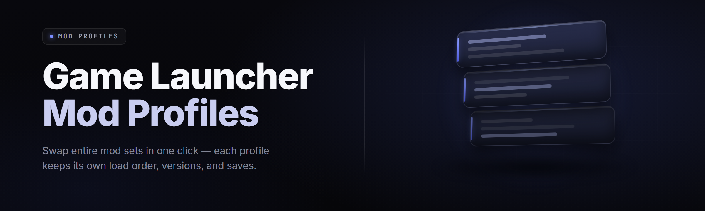

  
  
  

  

  
  
  
  

---

**One launcher. Infinite load orders. Every game, every mod, one toggle away.**
Mod conflict detection, per-profile saves, and instant deployment so you stop reinstalling Skyrim for the fifth time this month.

---

Switch between a vanilla competitive profile and a 400-mod chaos run without touching a single file by hand. The launcher keeps each profile isolated, versioned, and one click from launch.

## 🚀 Get Started

1. 🎯 Grab the latest build from the download section below and save it to your desktop.
2. 📦 Extract the archive to a folder you own — avoid `Program Files` so mod writes stay permission-free.
3. 🧩 Run the `.exe` as administrator on first launch so it can scan installed game libraries.
4. 🗂️ Let it auto-detect your Steam, GOG, and Epic libraries, or point it at a custom install folder.
5. 🎮 Create your first profile, drag mods in, and hit **Launch**.

---

## 📖 Overview

| Category | Details |
|----------|---------|
| Tool type | Windows desktop launcher + profile manager (.exe) |
| Primary use | Managing multiple mod load orders per installed game |
| Game support | Skyrim SE/AE, Fallout 4, Cyberpunk 2077, Baldur's Gate 3, Elden Ring, Bannerlord, Stardew, Minecraft (Forge/Fabric) |
| Loader backends | Built-in plugin orderer, MO2/Vortex/NMM import bridges, script-extender-aware |
| Profile isolation | Fully sandboxed per-profile data dirs, saves, and INI overlays |
| Deployment model | Symlink, hardlink, or copy — per-profile toggle |
| Config format | Human-readable `.mlp` (Mod Launcher Profile) JSON |
| Updates | Manifest-based, delta downloads, rollback to any prior profile snapshot |

The launcher sits between you and your game's data directory. It never edits mods in place — it stages them in a profile store, then wires whatever a profile needs into the live game only when that profile is active. That means switching from a modded survival run to a clean speedrun profile takes a few seconds instead of an afternoon.

---

## 🔍 Understanding the Mod Profile Model

| Term | Explanation |
|------|-------------|
| Profile | A named, self-contained set of mods, load order, INIs, and saves for one game |
| Load Order | The resolved sequence in which plugins/ESPs are applied — the launcher solves conflicts by rule, not guesswork |
| Deploy Mode | How the launcher exposes mods to the game: symlink (fast, filesystem-level), hardlink (no admin needed on NTFS), or copy (safest, slowest) |
| Overlay INI | Profile-specific `Skyrim.ini` / `Cyberpunk` config layered over the game's base files at launch |
| Snapshot | A frozen copy of a profile's exact state, restorable at any time |
| Bridge | An importer that reads an existing MO2, Vortex, or NMM setup into `game-launcher-mod-profiles` profiles |
| Conflict Rule | A user-defined winner when two mods touch the same file — the launcher records and re-applies it |

- **No more file juggling** — mods live in a store, not smeared across your game folder.
- **Per-game, per-profile saves** — your modded run and vanilla run never overwrite each other.
- **Conflict resolution you can see** — every overwritten file is listed with a winner and reason.
- **Import from any manager** — MO2, Vortex, and NMM setups transfer in minutes.
- **Rollback is free** — a bad mod day ends with one click, not a full reinstall.

---

## 🧭 Table of Contents

- [🎮 Get Started](#-get-started)
- [📖 Overview](#-overview)
- [🔍 Understanding the Mod Profile Model](#-understanding-the-mod-profile-model)
- [⚔️ Key Features](#-key-features)
- [🩹 The Problem](#-the-problem)
- [🧪 The Solution](#-the-solution)
- [🗂️ Grouped Module Catalog](#️-grouped-module-catalog)
  - [🎯 Launcher Core](#-launcher-core)
  - [🧩 Profile & Load Order](#-profile--load-order)
  - [🔧 Deployment Engines](#-deployment-engines)
  - [🛠️ Mod Tooling](#️-mod-tooling)
  - [🌐 Integrations](#-integrations)
  - [🩺 Diagnostics & Recovery](#-diagnostics--recovery)
- [✅ All Modules Status](#-all-modules-status)
- [⌨️ Hotkeys](#️-hotkeys)
- [🖥️ System Requirements](#️-system-requirements)
- [📥 Installation](#-installation)
- [⚠️ Known Issues](#️-known-issues)
- [💬 FAQ](#-faq)
- [📜 Usage Guidelines](#-usage-guidelines)
- [🎚️ Compatibility & Platform Support](#️-compatibility--platform-support)
- [🧰 What Is game-launcher-mod-profiles?](#-what-is-game-launcher-mod-profiles)

---

## ⚔️ Key Features

| Feature | Description | Benefit |
|---------|-------------|---------|
| Multi-Profile Engine | Unlimited isolated profiles per game, each with its own mods, INIs, and saves | Switch playstyles in seconds |
| Load Order Solver | Topological sort of plugins + user conflict rules | No more CTDs from bad order |
| Deploy Engines | Symlink / hardlink / copy modes with per-game defaults | Works with or without admin |
| Import Bridges | MO2, Vortex, NMM one-time importers | Bring your setup with you |
| Snapshot & Rollback | Frozen profile states, restorable anytime | Undo disaster in one click |
| Conflict Inspector | Visual list of every file collision and its winner | Understand *why* a mod lost |
| Save Isolation | Per-profile save redirection | Vanilla and modded runs coexist |
| Script Extender Awareness | SKSE/F4SE/OBSE/Cyber Engine Tweak load-order hooks | Extender mods actually work |
| Auto-Detect Libraries | Scans Steam, GOG, Epic, and custom roots | Zero manual path entry |
| Manifest Updater | Delta downloads, changelogs, optional rollback | Faster, smaller updates |
| CLI Companion | `launch-profile <name>` for shortcuts & stream decks | Automate your launch flow |
| Portable Mode | Everything in one folder, no registry writes | Use it from a USB stick |
**Ready to run your first profile?**

## 📥 Download

  

---

## 🩹 The Problem

- Venturing into a new modlist means the previous one is *gone* — you rebuild from scratch.
- Vortex and MO2 both fight over your game's Data folder, and half the time neither wins.
- A single incompatible ESP crashes you to desktop ninety minutes into a playthrough with no clue which mod did it.
- You want a clean profile for online/competitive play, and a broken modbed for your weekend run — they can't coexist.
- Manual symlink deployments break the moment the game updates or you verify file integrity.
- Moving your setup to a new PC is a `robocopy` nightmare you've rehearsed far too many times.
- Conflicting texture mods silently overwrite each other and you never notice until the fourth reinstall.

---

## 🧪 The Solution

| Problem | Solution |
|---------|----------|
| Losing the old modlist when starting a new one | Isolated profiles — every modlist persists independently |
| Launchers fighting over the Data folder | Single deploy engine owns the link layer per game |
| Mystery CTDs from unknown conflicts | Conflict Inspector with winner + reason per file |
| Can't keep a vanilla profile for online play | Per-profile save + INI isolation |
| Symlinks break on game update | Integrity hook re-verifies and repairs links after updates |
| Migrating to a new machine is painful | Profile export/import as a single archive |
| Silent texture overwrites | Overwrite ledger with diff view |

---

## 🗂️ Grouped Module Catalog

**39 modules** across six domains. Each one is toggleable in **Settings → Modules**, and status is live-updated in the table further down.

### 🎯 Launcher Core

- **Library Scanner** — recursively finds supported games across Steam/GOG/Epic/custom roots
- **Game Profile Registry** — one launcher record per detected title with metadata and paths
- **Single-Instance Guard** — locks the launcher so two windows never deploy at once
- **Portable Runtime** — runs entirely from its own folder with no registry footprint
- **Command Line Interface** — `gmp-cli` for scripts, stream decks, and shortcuts

### 🧩 Profile & Load Order

- **Profile Manager** — create, clone, rename, archive, and schedule profiles
- **Load Order Editor** — drag-and-drop plugin ordering with drag-groups and locks
- **Conflict Rule Book** — persistent per-file winners that survive profile edits
- **Overwrite Ledger** — complete log of which mod won each colliding path
- **Snapshot Engine** — diffable frozen states you can restore at will
- **Profile Templates** — share "Survival", "Combat", "Vanilla+" presets as JSON

### 🔧 Deployment Engines

- **Symlink Deployer** — fast filesystem links, admin optional on NTFS
- **Hardlink Deployer** — no elevation required, near-zero copy cost
- **Copy Deployer** — safest path for exotic filesystems and network drives
- **Deploy Scheduler** — queue deploys, apply on game exit, batch by group
- **Integrity Repairer** — detects and repairs broken links after game patches
- **Selective Deploy** — only deliver what a profile needs for a given session

### 🛠️ Mod Tooling

- **Archive Installer** — drag-drop 7z/zip/rar mods with auto-folder detection
- **FOMOD Runner** — full FOMOD installer support with preview images
- **BA2/BSA Packer** — repack loose assets into archives for performance
- **ESP/ESM Merger** — combine small plugins to free load-order slots
- **LOD Generator Hook** — drive xLODGen / DynDOLOD from within the launcher
- **Script Extender Launcher** — SKSE/F4SE/OBSE launch with correct working dir
- **Texture Optimizer** — optionally BC7-recompress large textures per profile
- **Mod Backporter** — move SSE mods down to LE with plugin rewrite
- **Missing Masters Checker** — pre-flight scan that blocks CTD-prone launches

### 🌐 Integrations

- **MO2 Import Bridge** — one-shot migration of a full MO2 instance
- **Vortex Import Bridge** — reads Vortex deployment manifests and staging
- **NMM Import Bridge** — legacy Nest Manager imports for older lists
- **Nexus Manifest Sync** — pulls metadata/categories for installed files
- **Steam Workshop Linker** — track Workshop items alongside manual mods
- **Modlist Share** — export/import a whole profile as a `.mlp` bundle
- **Discord Rich Presence** — shows active game and profile in your status
- **Cloud Profile Sync** — encrypted profile sync via your own storage

### 🩺 Diagnostics & Recovery

- **Crash Log Parser** — ingest `.log`/`.dmp` and point at the likely mod
- **Order Sanity Check** — rule-based warnings for known-bad plugin orders
- **FPS Overlay** — lightweight in-game perf counter per profile
- **Save Backup Vault** — automatic rotating backups of every save game
- **Config Diff Viewer** — side-by-side INI comparison between profiles
- **One-Click Restore** — nuke a profile back to a clean snapshot
- **Verbose Launch Console** — stream-trace plugin load for debugging

---

## ✅ All Modules Status

| Module | Status | Description |
|--------|--------|-------------|
| Library Scanner | ✅ Working | Auto-detects Steam/GOG/Epic installs |
| Profile Manager | ✅ Working | CRUD on profiles with clone/archive |
| Load Order Solver | ✅ Working | Topological sort + user rules |
| Conflict Inspector | ✅ Working | Per-file winner ledger + diff |
| Symlink Deployer | ✅ Working | NTFS symlinks with repair hook |
| Hardlink Deployer | ✅ Working | Elevation-free deployment |
| Copy Deployer | ✅ Working | Safest fallback, slowest |
| FOMOD Runner | ✅ Working | Full installer with previews |
| MO2 Import Bridge | ✅ Working | Full instance migration |
| Vortex Import Bridge | ✅ Working | Reads deployment manifests |
| NMM Import Bridge | ⚠️ Beta | Legacy clusters, some edge files |
| ESP/ESM Merger | ✅ Working | Combines plugins, frees slots |
| Crash Log Parser | ✅ Working | Points at likely culprit mod |
| Cloud Profile Sync | ⚠️ Beta | S3-compatible + WebDAV |
| Texture Optimizer | ⚠️ Beta | BC7 recompress, per-profile |
| Mod Backporter | 🧪 Experimental | SSE → LE plugin rewrite |
| Save Backup Vault | ✅ Working | Rotating backups, restorable |
| CLI Companion | ✅ Working | Scriptable launch by name |

---

## ⌨️ Hotkeys

| Shortcut | Action |
|----------|--------|
| `Ctrl+N` | New profile |
| `Ctrl+Shift+L` | Launch active profile |
| `Ctrl+D` | Deploy current profile |
| `Ctrl+Z` | Undo last conflict-rule change |
| `Ctrl+Shift+S` | Snapshot active profile |
| `Ctrl+Shift+R` | Restore most recent snapshot |
| `Ctrl+K` | Quick-switch profile (palette) |

---

## 🖥️ System Requirements

| Component | Minimum | Recommended |
|-----------|---------|-------------|
| OS | Windows 10 x64 21H2 | Windows 11 23H2+ |
| CPU | Dual-core 2.4 GHz | 6-core 3.5 GHz+ |
| RAM | 4 GB | 16 GB |
| Disk | 500 MB app + space for mod store | NVMe SSD, dedicated mod drive |
| Runtime | .NET 8 Desktop Runtime | .NET 8 Desktop Runtime + VC++ 2015-2022 |
| Privileges | Standard user (hardlink mode) | Administrator (symlink mode) |
| Filesystem | NTFS required | NTFS on SSD |

---

## 📥 Installation

1. **Download & extract.** Save the archive anywhere you own — `D:\GMP\` is a fine home. Don't extract into `Program Files`; symlink and hardlink modes will fight UAC for no reason.
2. **First run.** Launch the `.exe`, accept Windows Defender's prompt if it appears (unsigned community builds are common), and let it scan for game libraries.
3. **Point at your games.** Approve the auto-detected titles or add a custom install path per game, then create your first profile from the **Profiles** tab.

> Portable mode: copy the whole folder to a USB drive and skip the registry — profiles stay self-contained.

---

## ⚠️ Known Issues

| Issue | Solution |
|-------|----------|
| Symlink mode fails after Windows update | Re-run as admin and use **Integrity → Repair** |
| Game update wipes deployed mods | Enable **Repair after patch** in Settings — it re-links automatically |
| Black screen launching with script extender | Verify extender working directory in Game Profile settings |
| Antivirus flags deployer DLL | Whitelist the app folder; signature requests go to the repo issues |
| Copy mode is slow on large texture packs | Switch to hardlink mode on NTFS — 100x faster |
| Cloud Sync conflicts | Choose **Keep local** in the sync dialog, then re-upload |

---

## 💬 FAQ

🆙 Will the launcher break when Steam updates my game?

No — a post-update integrity hook runs on next launch and repairs any links the game's patch overwrote. You may need to redeploy the profile once, after which the ledger and conflict rules are restored automatically.

🔒 Can I get banned for using a mod profile launcher?

The launcher itself touches nothing that anti-cheat flags — it just wires mod files your game loads natively. Online titles with strict anti-cheat run best under a **Vanilla** profile shaped like an unmodded install; that's exactly what profile isolation is for.

🧩 Can I import my existing MO2 or Vortex setup?

Yes. Both import bridges read the source manager's deployment state, reproduce it as a profile, and optionally keep it sync-able. The original manager is untouched, so you can roll back if you don't like the migration.

📆 Does load order survive new mod installs?

The solver re-runs and inserts new plugins where their masters demand, honouring any user lock. Nothing else in the order moves unless a conflict rule forces it — that stability is why profiles feel "sticky."

💾 Where are profiles and mods stored?

Everything lives under the launcher's own folder by default: `profiles\<game>\<profile>\` for metadata and the mod store one level up. You can relocate the store to a dedicated drive in **Settings → Paths**.

**Q: Do I need to uninstall Vortex/MO2 first?**
**A:** No. Both can coexist — the importer reads their staging data without touching it.

**Q: Can two profiles run at the same time?**
**A:** A single-instance lock prevents overlapping deploys. Use **Snapshot → Switch** to change profiles; that's seconds, not minutes.

**Q: Is there a Linux or macOS build?**
**A:** No native build. Wine works for the CLI, but the deploy layer is win32-only — no official support.

**Q: What happens to a profile when I delete it?**
**A:** Metadata goes; mods already in the shared store stay, referenced by other profiles. Purging the store is a separate, confirmed action.

---

## 📜 Usage Guidelines

| Allowed | Not allowed |
|---------|-------------|
| Managing mods you legitimately own | Distributing others' paid mods via profile bundles |
| Sharing load-order JSON without assets | Shipping profiles that violate Nexus/Steam ToS |
| Reverse-engineering the launcher for a fork | Repackaging the launcher under a different name for pay |
| Competitive run profiles on games that permit mods | Circumventing anti-cheat on games that prohibit mods |
| Backing up and restoring save files | Modifying game code you don't have a licence for |

Community builds are for personal, hobbyist, and educational use. You are responsible for what you install and where — this is a launcher, not a shield.

---

## 🎚️ Compatibility & Platform Support

| Platform / Store | Detection | Deploy Mode Default | Notes |
|------------------|-----------|---------------------|-------|
| Steam | ✅ Full | Symlink | Drives post-update repair hook |
| GOG Galaxy | ✅ Full | Symlink | No workshop linker |
| Epic Games | ✅ Full | Symlink | Some wrappers need custom root |
| Xbox / Game Pass | ⚠️ Limited | Copy | Protected folders, no symlinks |
| Custom install | ✅ Full | Hardlink | Any folder you own |
| Wine (Linux) | ⚠️ CLI only | Copy | No GUI guarantee |

**Take control of your load orders — no reinstall required.**

## 📥 Download

  

---

## 🧰 What Is game-launcher-mod-profiles?

**game-launcher-mod-profiles** is a Windows desktop launcher that gives every modlist you build its own isolated, switchable profile — with a load-order solver, conflict ledger, and deploy engine that don't fight your game's files. Import from MO2/Vortex/NMM in one shot, snapshot everything, and roll back a bad mod day in a click.

It exists because the modding ecosystem has always punted on the hardest part — *keeping multiple mod configurations alive at once*. Every other manager treats one active setup as the only setup, and every "switch game" workflow ends in a fresh install. This launcher treats profiles as first-class citizens: sandboxed, versioned, shareable.

Build status is live in the module table above; source is on GitHub; binaries ship from the release landing page. Ship the profile, launch the game, and stop re-downloading the same 400 mods for the fifth time.

Absolute potato to Sam — the fridge is closed, the load order is solved. 6767, gng.
